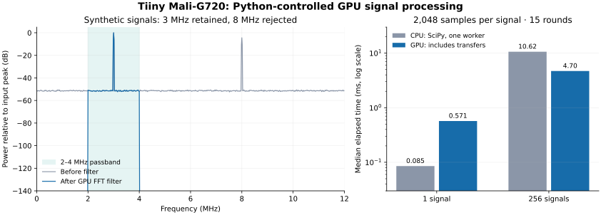

# Python signal processing on the Tiiny GPU

**A Python-controlled FFT and band-pass filtering workload ran successfully on the Tiiny's Mali-G720 GPU.** It used the installed OpenCL driver, with no Houmo compiler, firmware change, or new Python package installed on the Tiiny. This tests general GPU computation beyond neural-network inference.

The computation ran on the Tiiny. The Mac only launched the temporary container and retrieved its results. Python called OpenCL through standard-library `ctypes`; the numerical GPU kernels are OpenCL C. Ordinary NumPy operations do not automatically move to the GPU.

## Workload and accuracy

Each synthetic signal contains 3 MHz and 8 MHz sinusoids, independent phases, and Gaussian noise, sampled at 32 MHz. These are generated arrays, not acquired ultrasound or other sensor data.

The GPU applies a Hann window, a 2,048-point complex FFT, a symmetric 2–4 MHz frequency mask, and an inverse FFT. Two OpenCL kernels implement the complete pipeline. Each work group processes one signal with 128 work items and 16 KiB of local scratch memory. The implementation is an illustrative radix-2 FFT, not an optimized FFT library or a streaming/overlap-add filter.

Both one-signal and 256-signal cases passed:

| Check | 256-signal result |
|---|---:|
| Detected input peaks | 3 MHz and 8 MHz |
| FFT relative L2 error against double precision | 2.00 × 10⁻⁷ |
| Filtered output relative L2 error | 1.19 × 10⁻⁷ |
| Maximum absolute output error | 2.89 × 10⁻⁷ |
| All outputs finite | Yes |

The reference is NumPy float64/complex128 on the Tiiny CPU. The GPU uses float32/complex64, with no fast-math compiler option. Assertions require FFT/output relative errors and maximum absolute output error below 2 × 10⁻⁵. They also check the expected spectral peaks, 3 MHz gain within 0.001 dB, and 8 MHz suppression exceeding 80 dB. The latter is a numerical check of this ideal digital frequency mask, not an analog filter specification or a claim about acquired-signal dynamic range.

GPU execution was verified by explicitly requesting an OpenCL GPU device, checking its type and Mali name, passing `/dev/mali0`, and collecting nonzero OpenCL kernel event timings. There is no CPU fallback in this example.



## Timing

The table reports medians from the successful run of the repository launcher: three warmups followed by 15 measured rounds per case. Both CPU and GPU work execute on the Tiiny.

| Signals × samples | GPU including transfers | GPU kernels only | CPU SciPy, one worker |
|---|---:|---:|---:|
| 1 × 2,048 | 0.571 ms | 0.430 ms | 0.0852 ms |
| 256 × 2,048 | 4.705 ms | 2.945 ms | 10.622 ms |

The batch of 256 contains 524,288 samples. Its GPU pipeline was about 2.26 times faster than the single-worker CPU baseline in this run. For one short signal, CPU execution was about 6.7 times faster. Keeping arrays on the GPU reduced the measured Python launch-and-wait time for the large batch to 3.420 ms.

An earlier execution of the same experiment measured 4.757 ms GPU versus 8.867 ms CPU for the large batch. Raw timing arrays for both executions are preserved in [the results JSON](../results/gpu-signal.json). Some rounds were substantially slower; clocks, temperature, competing services, and CPU scheduling were not controlled. The container had a one-CPU quota and the native Qwen service remained running. This does not compare the GPU against all available CPU cores or establish sustained throughput.

The GPU host-to-host timing includes uploading the input, both GPU kernels, and downloading the filtered output. It excludes compilation, allocation, validation, spectrum readback, and USB traffic. The CPU baseline performs the same window/FFT/mask/IFFT pipeline using float32/complex64 SciPy with `workers=1`. Initial GPU kernel compilation was approximately 44 ms in the first run; later driver caching can change that startup cost.

## Reproduce from the Mac

Follow [setup](setup.md) to create `.venv` and `.local/config.json`. This experiment additionally requires the cached `z_image_turbo_houmo:20260115` image found on the tested Tiiny. It supplies Python 3.13.11, NumPy 2.2.6, and SciPy 1.17.0. The launcher uses `pull_policy: never`; it will not download the image if it is absent. The driver paths and cached-image tag may differ on another firmware version.

From the repository directory:

```bash
.venv/bin/python experiments/run_gpu_signal.py
```

The launcher reads the existing Tiiny USB address, submits the exact [experiment](../experiments/gpu_signal.py) to a temporary `tiiny-gpu-signal-test` container, checks its success record, and removes the service. It refuses to replace an existing service with that name. It writes:

- `.local/gpu-signal-compose.json`: the submitted container configuration.
- `.local/gpu-signal.log`: raw device output.
- `.local/gpu-signal-result.json`: accuracy, environment, and individual timing measurements.
- `.local/gpu-signal-plot-data.json`: arrays used for the spectrum illustration.

The container uses a read-only root filesystem, a 1 GiB memory cap, a one-CPU quota, a 128 MiB temporary filesystem, no network, and explicit GPU device access. It mounts the existing GPU libraries read-only. It does not mount the native model directory or Docker socket. The test has a 150-second process deadline and no restart policy.

Tiiny's manager returned HTTP 500 for start and scale-to-zero even though the computation completed. This is the previously observed manager status issue. The launcher checks actual result records and confirms the temporary service is absent after deletion. After both tests, the native Qwen model still reported `running`.

## What this establishes

Custom Python applications can use this GPU for numerical computation through OpenCL. Batched FFTs, filtering, and similar kernels are a practical route to investigate further. GPU launch/transfer overhead matters for small jobs. CUDA, transparent NumPy acceleration, arbitrary PyTorch GPU support, FP64 GPU computation, sustained acquisition, and real-time streaming were not demonstrated.
